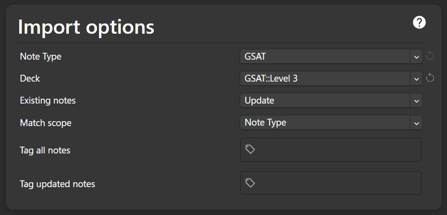

# Anki GSAT Card Setup Guide

## 0. Prerequisites

- Install Anki
- Launch the application

## 1. Create Note Type

- Click `Tool` (at the top left)
- Click `Manage Note Types`
- Click `Add` (this copies the Basic Note Type)
- Click `OK`
- Give it a name, say, `GSAT`
- Select it in the menu
- Click `Cards` on the right

## 2. Card Templates

You can find the HTML and CSS templates in the `templates/` folder:

- **`templates/front.html`**: Front template.
- **`templates/back.html`**: Back template.
- **`templates/card.css`**: Styling.

Copy the contents of these files directly into the corresponding sections of your Anki Note Type.

## 3. Import & Deck Organization

The vocabulary is organized by levels. You can choose to import everything into one deck or create a separate deck for each level. Either way, you should still create a deck.

### Create a Deck

1. Create a deck by clicking `Add` (at the top), then `Deck`, then `Add`
2. Give it a name, say, `GSAT`

### Importing Data

Here, we will go through the process of importing Level 3 as an example.

1. Create a subdeck by clicking `Add` (at the top), then `Deck`, then `Add`
2. Give it a name, say, `GSAT::Level 3`, then `OK`, and `Close` (`deck::subdeck` creates a deck `subdeck` under `deck`)
3. In Anki, click `Import File` (at the bottom)
4. Select the level file (e.g., `data/Anki/level3_import.tsv`).
5. In the `Import File` dialog:

   - `File`
  
     - Check "Allow HTML in fields" (if it's unchecked)

   - `Import Options`

   

     - **Note Type:** Select the `GSAT` Note Type created in Step 1
     - **Deck:** Click the subdeck name you created
     - **Existing Notes:** `Update`
     - **Match Scope:** `Note Type`

6. Click `Import`
7. Repeat for each level you wish to add